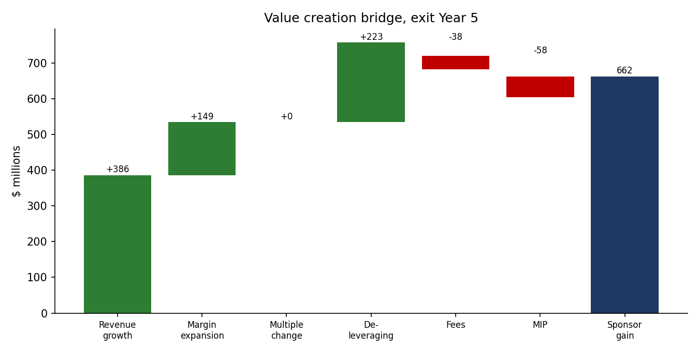
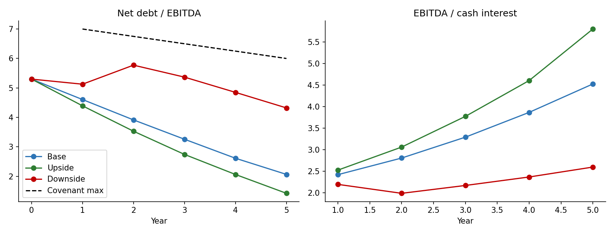
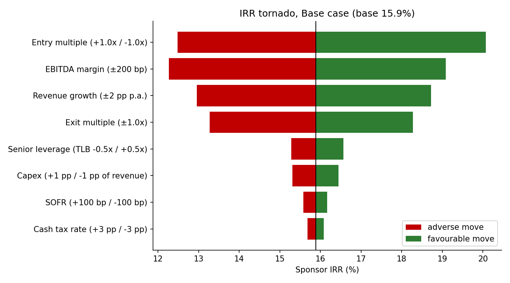
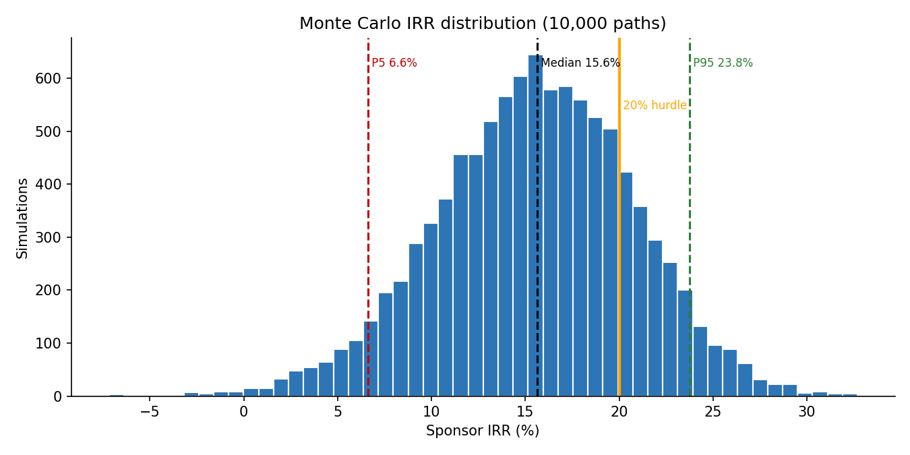

# Investment Committee Memo: Project Atlas

> **FICTIONAL CASE STUDY.** Project Atlas is an invented industrial-services business and every input is an illustrative assumption,
> not company data. The memo and the Excel model (`models/Project_Atlas_LBO.xlsx`) are generated from the same Python engine and reconciled to
> 1e-9, so every number below ties to the workbook. Educational use only; not investment advice.

## 1. Executive summary

- **Transaction:** acquire 100% of Atlas for **$1,100mm EV (11.0x LTM EBITDA of $100mm; 2.2x revenue)**, funded with $550mm of debt (5.5x) and $608mm of sponsor equity (52.5% of capitalisation).
- **Base-case returns (Year 5 exit at 11.0x):** **15.9% IRR / 2.09x MOIC** after a 8% management incentive plan (MIP).
- **Range:** Upside 21.6% / 2.66x; Downside 1.7% / 1.09x. Monte Carlo (10,000 paths) median IRR **15.6%**, 5th to 95th percentile **6.6% to 23.8%**, probability of losing capital **0.4%**.
- **Credit:** leverage falls from 5.3x to 2.1x net by Year 5; interest cover starts at 2.4x; the maintenance covenant is never breached in any of the three cases.

**Recommendation: proceed to confirmatory diligence, but do not bid 11.0x.** At 11.0x the base case returns 15.9% / 2.09x, below the 20% hurdle. The credit is sound (see below), so the issue is price, not risk of loss. Ability-to-pay analysis says 10.0x clears 20% with the same capital structure and operating case.

## 2. Transaction overview

| Sources | $mm | x EBITDA | Uses | $mm |
|---|---:|---:|---:|---:|
| Revolver (drawn; $75mm commitment) | $0.0 | 0.0x | Purchase of enterprise | $1,100.0 |
| Term Loan B (S+375 bp, 1% amort., 75% sweep) | $400.0 | 4.0x | Transaction fees (2.0% of EV) | $22.0 |
| Senior unsecured notes (9.25% fixed, bullet) | $150.0 | 1.5x | Financing fees (2.5%) | $15.6 |
| Sponsor equity | $607.6 | 6.1x | Minimum cash to balance sheet | $20.0 |
| **Total sources** | $1,157.6 | 11.6x | **Total uses** | $1,157.6 |

## 3. Investment thesis (illustrative)

1. **Resilient, recurring demand.** Mandatory inspection and testing work gives a defensive revenue base, which is why a 5.5x structure is financeable and covenant headroom stays wide.
2. **Operating leverage.** Margin moves from 20.0% at close to 21.5% by Year 3 and 22.0% by Year 5 (200 bp) from route density and pricing. After entry price, ebitda margin is the largest IRR driver in the tornado; this is the assumption diligence must stress hardest.
3. **Cash generation funds deleveraging.** $223mm of cumulative free cash flow after debt service over 5 years repays debt and builds cash, contributing 34% of the sponsor gain.
4. **No multiple expansion is underwritten.** Exit = entry multiple. Returns come from growth and cash flow, not re-rating.

## 4. Base-case projections

| $mm | Close | Y1 | Y2 | Y3 | Y4 | Y5 |
|---|---:|---:|---:|---:|---:|---:|
| Revenue | $500.0 | $535.0 | $572.5 | $606.8 | $643.2 | $675.4 |
|   growth | - | 7.0% | 7.0% | 6.0% | 6.0% | 5.0% |
| EBITDA | $100.0 | $109.7 | $120.2 | $130.5 | $141.5 | $148.6 |
|   margin | 20.0% | 20.5% | 21.0% | 21.5% | 22.0% | 22.0% |
| Capex | - | $21.4 | $22.9 | $24.3 | $25.7 | $27.0 |
| Cash interest | - | $45.2 | $42.8 | $39.6 | $36.6 | $32.8 |
| Cash taxes | - | $14.5 | $16.0 | $17.5 | $20.2 | $22.7 |
| Free cash flow (post debt service) | - | $24.7 | $34.5 | $45.5 | $55.3 | $63.0 |
| Term Loan B | $400.0 | $380.5 | $349.7 | $307.9 | $255.9 | $195.7 |
| Net debt | $530.0 | $505.3 | $470.8 | $425.3 | $370.0 | $307.0 |
| Net debt / EBITDA | 5.30x | 4.61x | 3.92x | 3.26x | 2.61x | 2.07x |
| EBITDA / cash interest | - | 2.42x | 2.81x | 3.29x | 3.87x | 4.53x |
| Covenant (max net lev.) | - | 7.00x | 6.75x | 6.50x | 6.25x | 6.00x |

## 5. Returns and value creation

Exit in Year 5 at 11.0x EBITDA of $148.6mm gives enterprise value of $1,634mm, less net debt of $307mm, equals equity value of $1,327mm; after the MIP, sponsor proceeds are $1,270mm on $608mm invested.

| Driver | $mm | % of gain |
|---|---:|---:|
| Revenue growth | $385.8 | 58.3% |
| Margin expansion | $148.6 | 22.4% |
| Multiple expansion | $0.0 | 0.0% |
| Deleveraging (FCF-funded debt paydown) | $223.0 | 33.7% |
| Fees and expenses | ($37.6) | -5.7% |
| Management incentive plan | ($57.6) | -8.7% |
| **Total sponsor gain** | $662.2 | 100.0% |

**Read-across:** returns are driven mostly by EBITDA growth (revenue and margin together 81%) and deleveraging (34%). There is no multiple contribution by construction; fees and the MIP are a 14% drag.

## 6. Scenarios

| Case | Rev Y5 | EBITDA Y5 | Margin | Net lev. Y5 | Min int. cover | Peak revolver | Cov. breaches | MOIC | IRR |
|---|---:|---:|---:|---:|---:|---:|---:|---:|---:|
| Base | $675.4 | $148.6 | 22.0% | 2.07x | 2.42x | $0.0 | 0 | 2.09x | 15.9% |
| Upside | $741.4 | $177.9 | 24.0% | 1.42x | 2.53x | $0.0 | 0 | 2.66x | 21.6% |
| Downside | $524.6 | $99.7 | 19.0% | 4.32x | 1.99x | $0.0 | 0 | 1.09x | 1.7% |

The Downside case is a Year-2 recession (revenue -4%, margin falling to 17.5%). Equity still returns capital (1.09x) because the cash sweep keeps deleveraging, but IRR is only 1.7%. Peak net leverage is 5.77x against a 6.75x covenant.

## 7. Valuation sensitivity (IRR; entry multiple down, exit multiple across)

| Entry \ Exit | 9.0x | 10.0x | 11.0x | 12.0x | 13.0x |
|---|---:|---:|---:|---:|---:|
| 9.5x | 16.7% | 19.8% | 22.6% | 25.1% | 27.5% |
| 10.0x | 14.3% | 17.3% | 20.1% | 22.6% | 24.9% |
| 10.5x | 12.3% | 15.2% | 17.9% | 20.3% | 22.6% |
| 11.0x | 10.4% | 13.3% | 15.9% | 18.3% | 20.5% |
| 11.5x | 8.7% | 11.5% | 14.1% | 16.5% | 18.6% |
| 12.0x | 7.2% | 10.0% | 12.5% | 14.8% | 16.9% |
| 12.5x | 5.8% | 8.5% | 11.0% | 13.3% | 15.4% |

**Ability to pay.** Holding structure and operating case constant, the maximum entry multiple that still earns 15% / 20% / 25% IRR is **11.2x / 10.0x / 9.1x**. Conversely, at 11.0x entry the exit multiple required for a 20% IRR is **12.8x** (multiple expansion we are unwilling to underwrite) and the exit multiple at which we only get our money back is **6.2x**.

## 8. Risk analysis

### 8.1 What moves the IRR (one factor at a time)

| Driver | Adverse | Favourable | Swing |
|---|---:|---:|---:|
| Entry multiple (+1.0x / -1.0x) | 12.5% | 20.1% | 7.6 pp |
| EBITDA margin (±200 bp) | 12.3% | 19.1% | 6.8 pp |
| Revenue growth (±2 pp p.a.) | 13.0% | 18.7% | 5.8 pp |
| Exit multiple (±1.0x) | 13.3% | 18.3% | 5.0 pp |
| Senior leverage (TLB -0.5x / +0.5x) | 15.3% | 16.6% | 1.3 pp |
| Capex (+1 pp / -1 pp of revenue) | 15.3% | 16.4% | 1.1 pp |
| SOFR (+100 bp / -100 bp) | 15.6% | 16.2% | 0.6 pp |
| Cash tax rate (+3 pp / -3 pp) | 15.7% | 16.1% | 0.4 pp |

Price paid, margin, growth and exit multiple dominate; financing terms (SOFR, leverage, tax) matter far less. Debt structure is not where this deal is won or lost.

### 8.2 Monte Carlo (10,000 paths)

Correlated shocks: annual growth (σ 2.0 pp common + 1.5 pp idiosyncratic), margin (σ 1.2 pp common, 0.6 correlation with growth, + 0.4 pp idiosyncratic), exit multiple (N(11.0x, 1.0x), clipped 7x to 15x), SOFR (σ 100 bp parallel).

| Statistic | Value |
|---|---:|
| Median IRR / MOIC | 15.6% / 2.07x |
| 5th / 25th / 75th / 95th percentile IRR | 6.6% / 12.0% / 19.1% / 23.8% |
| P(IRR ≥ 20%) | 19.5% |
| P(IRR ≥ 15%) | 55.0% |
| P(IRR < 10%) | 14.6% |
| P(MOIC < 1.0x), i.e. loss of capital | 0.4% |
| P(covenant breach in any year) | 0.0% |
| P(revolver drawn in any year) | 0.1% |

### 8.3 Break-even analysis (credit resilience)

| Test | Result |
|---|---:|
| Margin cut (all years, vs Base) before the revolver is first drawn | 475 bp |
| Margin cut before any year has negative free cash flow | 575 bp |
| Margin cut before the net-leverage covenant is breached | 650 bp |

Interpretation: a permanent 475 bp margin miss starts consuming liquidity, and a 650 bp miss trips the covenant. For scale, the Base case itself assumes only 200 bp of margin improvement, so the cushion is several times larger than the expansion we are underwriting.

## 9. Key risks and mitigants

| Risk | Why it matters | Mitigant / diligence action |
|---|---|---|
| Margin expansion not delivered | Second-largest IRR driver | Bottom-up route-density and pricing study; price/volume/mix bridge |
| Cyclical volume shock | Downside case shows IRR compression to 1.7% | Contract-mix analysis; test 2008-09 and 2020 revenue history |
| Floating-rate exposure | TLB is floating; SOFR ±100 bp moves IRR only ~0.6 pp but cash interest cover matters | Hedge 50-75% of the TLB for 3 years |
| Interest deductibility | The 30% EBITDA cap raises cash taxes in early years | Tax diligence; model as-is already includes the cap |
| Entry price | Single largest IRR lever | Disciplined bid ceiling at the ability-to-pay multiple |
| Exit environment | Multiple compression below 11x erodes returns quickly | Underwrite exit = entry; build a second exit path (strategic sale / IPO) |

## 10. Model methodology and limitations

- Integrated three-statement mechanics: income statement, cash flow, debt schedule with revolver and cash sweep, balance sheet (balance check = 0 in every period), returns, credit statistics and covenant tests. 11 sheets, ~800 live formulas, 9 automated integrity checks.
- **Interest is charged on beginning-of-year balances** to avoid circular references; this slightly overstates interest in a deleveraging deal (conservative).
- Cash-free / debt-free purchase; transaction fees capitalised into goodwill; no purchase-price allocation, deferred taxes or stock-based compensation; no NOL or interest carry-forwards.
- Sensitivity Tables 1-3 are live formulas; Tables 4-5 and the scenario columns are static Python snapshots (re-run `python -m lbo build` after changing inputs).
- Monte Carlo shocks are stylised and independent across years beyond the common factor; real downturns cluster and are fat-tailed, so treat tail probabilities as indicative.
